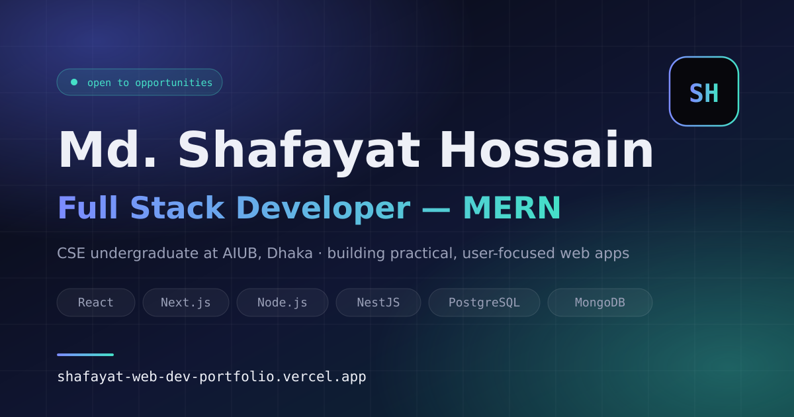

# Developer Portfolio — Md. Shafayat Hossain

**Live site → [shafayat-web-dev-portfolio.vercel.app](https://shafayat-web-dev-portfolio.vercel.app)**

My personal portfolio: a single-page site presenting my projects, stack and background as a MERN full stack developer and CSE undergraduate at AIUB, Dhaka.



---

## Built with

| | |
|---|---|
| **Framework** | React 19 + TypeScript |
| **Build tool** | Vite |
| **Styling** | Tailwind CSS v4 |
| **Animation** | Framer Motion |
| **Icons** | Lucide |
| **Hosting** | Vercel |

No UI kit or template — every component is written from scratch.

## Features

- **Command palette** (`⌘K` / `Ctrl+K`) for jumping to any section, project or link
- **Dark / light theme** persisted to `localStorage`, applied before first paint so there's no flash
- **Live GitHub stats** — public repo count, followers and most-used languages pulled from the GitHub REST API at runtime
- **Project detail modals** with per-project architecture notes, highlights and repo links
- **Filterable** skills and projects with shared-layout spring transitions
- **3D tilt cards** with a cursor-tracked light sheen, and magnetic hero buttons
- **Scroll-driven motion** — parallax hero, word-by-word heading reveals, animated proficiency bars and count-up stats
- **Working contact form** via Formspree, with a `mailto:` fallback
- **SEO** — Open Graph and Twitter card metadata, JSON-LD `Person` schema, canonical URL
- **Accessibility** — honours `prefers-reduced-motion`, keyboard-navigable palette and menus, ARIA labels on icon-only controls

## Running locally

```bash
git clone https://github.com/shafayat75/portfolio.git
cd portfolio
npm install
npm run dev
```

Then open the URL printed in the terminal (usually `http://localhost:5173`).

```bash
npm run build     # production build → dist/
npm run preview   # serve the production build locally
```

Requires Node.js 18 or newer.

## Project structure

```
src/
├── data/profile.ts        # all site content — the only file to edit for changes
├── lib/hooks.ts           # theme, typewriter, count-up, active section, GitHub API
├── components/
│   ├── common.tsx         # Section, SectionHeading, Reveal, ScrollProgress
│   ├── motion-kit.tsx     # Tilt, Magnetic, AnimatedText
│   ├── Nav · Hero · About · Skills · Projects · Journey · Contact · Footer
│   └── CommandPalette · Preloader · Spotlight · BrandIcons
├── index.css              # theme tokens and utility classes
└── App.tsx
```

All copy, projects, skills and links live in a single typed file, `src/data/profile.ts`, so content changes never touch component code.

## Projects featured

| Project | Stack |
|---|---|
| [ScholarStream](https://sparkling-sable-55715c.netlify.app) — scholarship management platform with role-based review workflows | React · Node · Express · MongoDB |
| StudyCircle — peer study group finder *(team project, in progress)* | Next.js · NestJS · PostgreSQL · Prisma |
| [HabitFlow](https://habit-flow-zz.netlify.app) — habit tracker with streaks | React · Node · MongoDB |
| Rocket_CSE — student/teacher portal with class recordings and MCQ tests | JavaScript · Node · REST |
| [Law Firm Website](https://shafayat75.github.io/law-website/) — responsive informational site | HTML · CSS · JavaScript |

## Contact

- **Email** — shafayathossainpranto2025@gmail.com
- **LinkedIn** — [shafayat-hossain-pranto](https://linkedin.com/in/shafayat-hossain-pranto)
- **GitHub** — [@shafayat75](https://github.com/shafayat75)

Open to internships and junior full stack roles.
